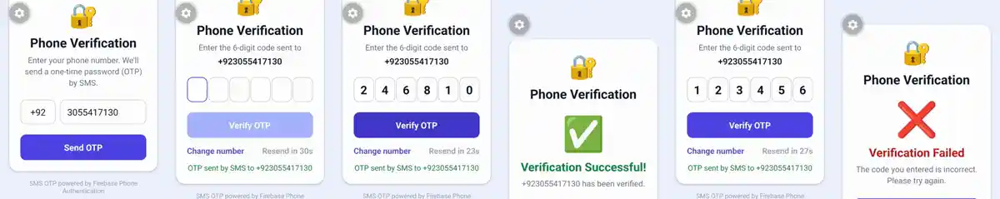
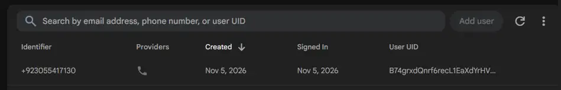

# OTP Phone Number Verification (React Native / Expo + Firebase)

Quiz 4: a React Native / Expo app that verifies a phone number with a one-time password (OTP) using **Firebase Phone Authentication**. It is not email-based.

## Features

1. Enter a phone number (country code + number).
2. Request an OTP from Firebase.
3. Enter the 6-digit OTP in a 6-box input.
4. Verify the OTP and see a **success ✅ or failure ❌** message.
5. Extras: resend OTP with a 30-second cooldown, change number, input validation, loading states and clear error messages (expired code, too many attempts, region blocked, invalid number).

## Tech stack

- React Native + Expo (runs in **Expo Go**)
- Firebase Authentication: Phone sign-in through the Identity Toolkit REST API

## How it works

| Step | Firebase API |
|------|--------------|
| Send OTP | `POST accounts:sendVerificationCode` with `{ phoneNumber }`. Firebase creates the OTP and returns a `sessionInfo`. |
| Verify OTP | `POST accounts:signInWithPhoneNumber` with `{ sessionInfo, code }`. A correct code signs the user in. A wrong code returns `INVALID_CODE`. |

```
Phone screen ── sendOtp(+923055417130) ──▶ Firebase Auth ── sessionInfo
OTP screen   ── checkOtp(sessionInfo, code) ──▶ Firebase Auth
Result       ✅ "Verification Successful"  or  ❌ "Verification Failed"
```

Firebase generates and checks the OTP on its own servers. The app never stores the code.

## Project structure

```
App.js                     UI: phone screen → OTP screen → result screen
src/otpService.js          OTP service used by the UI
src/providers/firebase.js  Firebase Phone Auth (send + verify)
.env.example               Template for the Firebase Web API key
```

## Setup

1. In the [Firebase Console](https://console.firebase.google.com), create a project.
2. Go to **Authentication → Sign-in method → Phone → Enable**.
3. Under **Phone numbers for testing**, add a number and a 6-digit code, e.g. `+92 305 5417130` → `246810`.
4. Go to **Authentication → Settings → SMS region policy → Allow → Pakistan**.
5. Go to **Project settings → General → Your apps → Web app** and copy the `apiKey`.
6. Run:
   ```bash
   npm install
   cp .env.example .env      # paste the apiKey into .env
   npx expo start -c
   ```
   Scan the QR code with **Expo Go**.

On the free Spark plan, Firebase does not send an SMS to test numbers. It accepts the code configured in step 3. Real SMS delivery to any number needs the Blaze plan, and the same code works without changes.

## Screenshots / Recording

Recorded on an Infinix X670 (Android 13) with Expo Go, Firebase Phone Authentication and test number `+92 305 5417130`.

**Full flow:** enter number → OTP sent → correct code `246810` → ✅ success → wrong code `123456` → ❌ failure



**Firebase Console → Authentication → Users:** the number was verified through Firebase Phone Auth



**Screen recording:** see `docs/demo.mp4`
